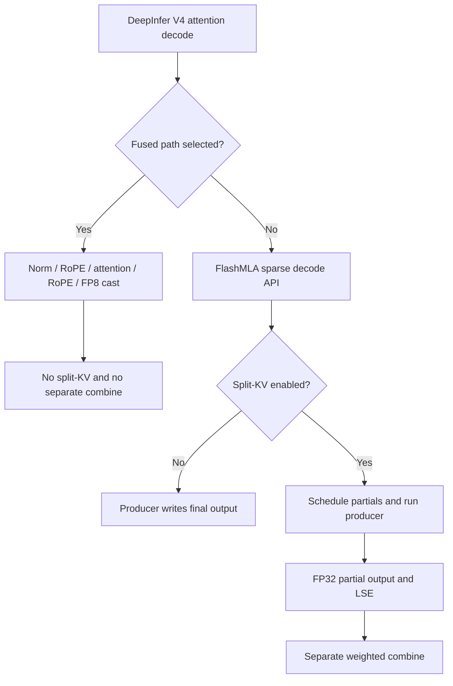

# Applying hierarchical reduction to current DeepInfer

Source audit: **24 October 2026, Asia/Shanghai**. This is a code-level
applicability assessment. No DeepInfer model or upstream SM100 kernel was
built, run or benchmarked for this audit. The existing H100 and RTX kernels,
dependencies and benchmark records are unchanged.

## Decision

**The idea remains applicable as an experiment on the non-fused split-KV
decode path. It is not a drop-in optimization for all DeepInfer attention.**
That path materializes FP32 partial outputs and launches a separate weighted
combine. The fused decode path explicitly disables split-KV, so it has no
separate combine to replace. It already uses TMA and, for 128 heads, a two-CTA
cluster. The opportunity is a better placement and schedule for merging
partial states, not the first use of TMA in this framework.
[Decode dispatch](https://github.com/deepseek-ai/DeepInfer/blob/9bd9cf243fc53ef9afbf8f04d391d989117d6ab9/deepinfer/model_executor/layers/attention_backend.py#L107-L146),
[split-KV launch](https://github.com/deepseek-ai/FlashMLA/blob/2e5429fc5653bab6e081f09477126f731882a6a9/csrc/api/sparse_decode.cpp#L382-L440),
[fused design](https://github.com/deepseek-ai/FlashMLA/blob/2e5429fc5653bab6e081f09477126f731882a6a9/csrc/cuda_kernels/sm100/prefill/sparse/fused_norm_rope_attn_rope_cast_fwd/core_attn/config.h#L18-L66).

The preserved project implements **hierarchical merging inside the Hopper
producer**, followed by a residual global combine. A standalone TMA loader
for the later combine would be a different implementation. The existing RTX
backend implements neither Hopper DSM exchange nor current DeepInfer kernels;
its timings do not establish DeepInfer speedups. See the
[Hopper readiness audit](HOPPER_RESEARCH_READINESS.md) and
[RTX measurements](RTX6000D_LOW_BATCH.md).

## Exact upstream revisions

"Latest" means main observed during this audit, not a floating dependency.

| Source | Commit | Commit date, UTC | Role |
|---|---|---|---|
| [Official DeepInfer](https://github.com/deepseek-ai/DeepInfer/tree/9bd9cf243fc53ef9afbf8f04d391d989117d6ab9) | `9bd9cf243fc53ef9afbf8f04d391d989117d6ab9` | 2026-10-21 | Framework main inspected |
| [DeepInfer's FlashMLA gitlink](https://github.com/deepseek-ai/DeepInfer/tree/9bd9cf243fc53ef9afbf8f04d391d989117d6ab9/vendor) | `2e5429fc5653bab6e081f09477126f731882a6a9` | 2026-09-30 | Dependency actually selected by the framework |
| [Official FlashMLA main](https://github.com/deepseek-ai/FlashMLA/tree/0f11e178da1f67becb087a324b400854931ec3e3) | `0f11e178da1f67becb087a324b400854931ec3e3` | 2026-10-15 | Checked separately for changes since the gitlink |

The inspected combine, scheduler, 64/128-head producers and fused core files
are byte-identical between the FlashMLA pin and main. API/Python/build files
changed with the stable-ABI migration; main retains the split gate and fused
no-split behavior. This is not a claim that the two entire repositories are
identical. [Source hashes and comparison scope](DEEPINFER_SOURCE_AUDIT.json)
record every downloaded file and the compared Git blob IDs. Kernel citations
below use the dependency pin.

DeepInfer publishes an offline inference core for DeepSeek-V4.1-Flash, with
NVIDIA SM100 and Ascend 950 support. It is not the older V3 dense-MLA API.
Its README also distinguishes the released core from unreleased serving
components. This audit traces NVIDIA decode; it does not assess every
framework operator or the Ascend implementation.
[Framework scope](https://github.com/deepseek-ai/DeepInfer/blob/9bd9cf243fc53ef9afbf8f04d391d989117d6ab9/README.md).

## Which path actually reaches combine?



`V4AttentionBase` selects fusion on GPU with exactly 64 or 128 query heads
when its layer/prompt conditions permit. In decode, sparse layers or layers
without packed KV qualify; dense packed-KV decode takes the non-fused route.
Other supported head counts can reach non-fused attention with head padding.
Consequently, the Python wrapper's name containing `sparse` does not prove
that every model layer takes the same fused path.
[Selection predicate](https://github.com/deepseek-ai/DeepInfer/blob/9bd9cf243fc53ef9afbf8f04d391d989117d6ab9/deepinfer/model_executor/models/v4_modules/attn.py#L84-L94),
[head padding and calls](https://github.com/deepseek-ai/DeepInfer/blob/9bd9cf243fc53ef9afbf8f04d391d989117d6ab9/deepinfer/model_executor/layers/attention_backend.py#L1-L25).

For the **non-fused NVIDIA API**, the gate is equivalent to:

```text
enable_split_kv = not enable_batch_invariant
                  and (topk_capacity + extra_topk_capacity > 640)
```

These capacities come from the index tensors' last dimensions. They are not
the current valid lengths or the original context length. Once enabled, the
scheduler uses per-query live lengths and can still assign just one split to
a query. Its producer writes final results directly in that case and the
launched combine returns early for that query.
[Gate and dimensions](https://github.com/deepseek-ai/FlashMLA/blob/2e5429fc5653bab6e081f09477126f731882a6a9/csrc/api/sparse_decode.cpp#L196-L224),
[live-length scheduling](https://github.com/deepseek-ai/FlashMLA/blob/2e5429fc5653bab6e081f09477126f731882a6a9/csrc/cuda_kernels/smxx/decode/get_decoding_sched_meta/get_decoding_sched_meta.cu#L42-L120),
[one-split early return](https://github.com/deepseek-ai/FlashMLA/blob/2e5429fc5653bab6e081f09477126f731882a6a9/csrc/cuda_kernels/smxx/decode/combine/combine.cu#L64-L69).

| Runtime route | Existing separate combine | Applicability |
|---|---|---|
| Fused decode | None; split-KV explicitly false | No direct replacement. Adding split-KV is a new fused-kernel design. |
| Non-fused, capacity sum greater than 640, batch invariance disabled | Launched; does useful merge work for queries with more than one split | Primary integration candidate |
| Non-fused, capacity sum at most 640 | None | No merge optimization to apply |
| Non-fused, batch invariance enabled | None | Preserve the no-split semantics; do not override the user's reproducibility mode |
| Ascend decode | Split-KV disabled in this API | NVIDIA DSM/TMA code is not portable to this branch |

The batch-invariance gate above belongs to the non-fused API. The fused call
does not forward that argument and already uses no split-KV. This source audit
does not measure how frequently production configurations select each route.

## Concrete code boundaries

| Component | Current behavior and proposed relevance |
|---|---|
| [Framework attention call](https://github.com/deepseek-ai/DeepInfer/blob/9bd9cf243fc53ef9afbf8f04d391d989117d6ab9/deepinfer/model_executor/models/v4_modules/attn.py#L640-L669) | Passes selected indices, optional second cache, live lengths, sink and fusion arguments. Instrument route/shape frequency here in a future integration experiment. |
| [Sparse API and scratch](https://github.com/deepseek-ai/FlashMLA/blob/2e5429fc5653bab6e081f09477126f731882a6a9/csrc/api/sparse_decode.cpp#L382-L440) | Owns scheduler tensors, FP32 scratch and the producer-to-combine boundary. |
| [Standalone combine](https://github.com/deepseek-ai/FlashMLA/blob/2e5429fc5653bab6e081f09477126f731882a6a9/csrc/cuda_kernels/smxx/decode/combine/combine.cu#L87-L183) | Uses vectorized global loads, LSE weighting and software accumulation; no TMA load in this combine. A standalone transfer experiment belongs here. |
| [64/128-head dispatch](https://github.com/deepseek-ai/FlashMLA/blob/2e5429fc5653bab6e081f09477126f731882a6a9/csrc/api/sparse_decode.cpp#L50-L120) | Uses different producers and SM-part budgets. A hierarchical implementation must account for both. |
| [64-head split epilogue](https://github.com/deepseek-ai/FlashMLA/blob/2e5429fc5653bab6e081f09477126f731882a6a9/csrc/cuda_kernels/sm100/decode/sparse/head64/kernel.cuh#L366-L396) | Already stages FP32 partial output with TMA stores. Hierarchical merging would change this producer boundary and its scheduling. |
| [128-head producer](https://github.com/deepseek-ai/FlashMLA/blob/2e5429fc5653bab6e081f09477126f731882a6a9/csrc/cuda_kernels/sm100/prefill/sparse/fwd_for_small_topk/head128/phase1.cuh#L49-L64) | Already uses a two-CTA cluster, including split-KV mode. Additional split cooperation must coexist with that arrangement. |
| [Fused decode setup](https://github.com/deepseek-ai/FlashMLA/blob/2e5429fc5653bab6e081f09477126f731882a6a9/csrc/api/fused_norm_rope_attn_rope_cast_fwd.cpp#L378-L410) | Disables split-KV and calls the fused core directly. |

The combine launches eight warps per CTA, one head per warp, with
`b * s_q * ceil(h_q / 8)` CTAs. At `b=s_q=1`, that is 8 CTAs for 64 heads
or 16 for 128 heads. This is a structural reason to investigate parallelism;
it is not a measured SM-utilization percentage or proof of bandwidth
saturation. [Launch geometry](https://github.com/deepseek-ai/FlashMLA/blob/2e5429fc5653bab6e081f09477126f731882a6a9/csrc/cuda_kernels/smxx/decode/combine/combine.cu#L189-L230).

The fused 128-head cluster divides value channels across two CTAs using
dual-CTA matrix operations and persistent Cluster Launch Control. Those
CTAs do not simply represent independent KV splits ready for our historical
merge. Reusing the word "cluster" does not make the algorithms equivalent.
[Fused ownership and scheduling](https://github.com/deepseek-ai/FlashMLA/blob/2e5429fc5653bab6e081f09477126f731882a6a9/csrc/cuda_kernels/sm100/prefill/sparse/fused_norm_rope_attn_rope_cast_fwd/core_attn/config.h#L38-L66).

## Contracts a port must preserve

| Aspect | Existing project / measured RTX backend | Current DeepInfer NVIDIA path |
|---|---|---|
| Attention geometry | QK=576, V=512; grouped query heads | QK=V=512, one KV head; 64/128 kernel heads, possibly padded by the wrapper |
| Cache input | FP16/BF16 paged storage in the RTX API | Token-interleaved quantized cache; FP8 main cache, optional FP8/FP4 second cache; explicit selected-token indices |
| Work size | Dense live context length and chosen splits | Selected-index capacity, per-query live lengths, compression/SWA, and per-device query count |
| Scratch layout | RTX uses fixed split count and row-major partials | Prefix-sum split indexing; FP32 output `[allocated_splits, s_q, h_q, 512]` and LSE `[allocated_splits, s_q, h_q]` |
| Output normalization | RTX has no attention sink | Optional FP32 per-head sink affects output normalization, but public LSE excludes the sink |
| Empty output | RTX: zero output, public LSE `-inf` | Upstream: zero output, public LSE `+inf` sentinel; preserve upstream's convention |
| Final representation | FP16/BF16 output | Non-fused BF16; fused permuted FP8 plus packed scale factors after output RoPE |
| Hardware implementation | Historical SM90 cluster code; independent SM120 Triton path | SM100-family matrix/TMEM/TMA kernels; fused path also uses CLC |

Contract sources: [sparse API validation](https://github.com/deepseek-ai/FlashMLA/blob/2e5429fc5653bab6e081f09477126f731882a6a9/csrc/api/sparse_decode.cpp#L226-L299),
[combine normalization](https://github.com/deepseek-ai/FlashMLA/blob/2e5429fc5653bab6e081f09477126f731882a6a9/csrc/cuda_kernels/smxx/decode/combine/combine.cu#L102-L146),
[fused interface](https://github.com/deepseek-ai/FlashMLA/blob/2e5429fc5653bab6e081f09477126f731882a6a9/flash_mla/fused_norm_rope_attn_rope_cast.py#L113-L153).

The merge algebra can transfer. For normalized partial vectors `o_i` and
base-2 log normalizers `ell_i`, a nonempty group forms
`L = log2(sum_i(2**ell_i))` using a stable maximum subtraction and
`O = sum_i(2**(ell_i-L) * o_i)`. Hierarchical groups can emit another `(O,L)`
pair. Keep empty-group masks explicit; do not feed a public `+inf` sentinel
back as an ordinary partial log weight. Convert final public LSE to natural
log. Apply the attention sink once in the final output normalization, not
once per group and again globally. Floating-point ordering changes still
require an independent reference and the intended batch-invariance checks.

Preserve the dependency protocol as well as arithmetic. The combine calls
`cudaGridDependencySynchronize()` and enables programmatic dependent launch.
The 64-head producer currently uses an ordinary launch with a comment
disabling PDL there. Do not infer useful overlap from the combine's launch
flag alone, or substitute loads without checking producer completion and
visibility. [Combine dependency](https://github.com/deepseek-ai/FlashMLA/blob/2e5429fc5653bab6e081f09477126f731882a6a9/csrc/cuda_kernels/smxx/decode/combine/combine.cu#L87-L98),
[producer launch](https://github.com/deepseek-ai/FlashMLA/blob/2e5429fc5653bab6e081f09477126f731882a6a9/csrc/cuda_kernels/sm100/decode/sparse/head64/kernel.cuh#L724-L735).

## Experiments worth pursuing

1. **Establish reachability first.** Record selected route, actual/padded
   query count, physical head count, capacity, live selected lengths,
   prefix split counts, cache format and batch-invariance mode per layer.
   A long original context does not imply a large selected KV set or an
   active combine. Establish the fraction of layer time actually exposed.
2. **Improve the separate combine as a controlled study.** Compare the
   existing vectorized implementation, a retiled SIMT implementation, and a
   TMA-staged variant on identical scratch and scheduling. Include descriptor,
   barrier, shared-memory and occupancy costs. TMA staging alone retains the
   global intermediate write/read boundary; it does not remove those bytes.
3. **Port the hierarchical idea separately.** Group only compatible splits
   of the same query/head state, merge them before global staging, and emit
   fewer residual partials. Redesign scheduler ownership, partial indexing,
   transaction completion and buffer reuse for the SM100 producers. Include
   the existing two-CTA 128-head organization in the resource model. The
   historical Hopper synchronization findings must not be copied forward.
4. **Treat split-KV inside the fused path as a later design question.**
   Normalization, output RoPE, quantization and layout must occur at the
   correct final boundary. Compare the entire fused segment with its existing
   implementation. Merely comparing a new merge against a nonexistent
   baseline combine would be misleading.

For DeepInfer the wrapper maps `total_q` to `b`, with `s_q=1`, on the non-fused
path. The fused interface expresses query tokens along `s_q` with implicit
batch one. CUDA Graph selection rounds the requested `total_q` up to a
captured size; record both real and padded tokens and account for speculative
decoding. Do not equate service request batch with kernel batch.
[Wrapper](https://github.com/deepseek-ai/DeepInfer/blob/9bd9cf243fc53ef9afbf8f04d391d989117d6ab9/deepinfer/model_executor/layers/attention_backend.py#L77-L146),
[graph selection](https://github.com/deepseek-ai/DeepInfer/blob/9bd9cf243fc53ef9afbf8f04d391d989117d6ab9/deepinfer/worker/cuda_graph_runner.py#L142-L148).

A model should therefore include dispatch state, `total_q`, padded heads,
selected lengths, split counts, producer geometry and cluster eligibility.
For output rows that actually split, logical partial storage is
`4 * (512+1) * sum_r(S_r)` bytes; an ideal write/read round trip doubles
that. Rows with `S_r=1` bypass that materialization. API allocation reserves
`b + num_sm_parts` split slots, so allocated capacity is different from
useful partial traffic. A cluster grouping factor C only approaches
`ceil(S_r/C)` residual partials when ownership and tails permit. These are
logical byte models, not measured HBM traffic or transferred RTX coefficients.

On compatible hardware, sweep total queries `{1,2,4,8,16,32}`, heads 64/128,
capacity sums below/at/above 640 using legal shapes, main-only and two-cache
inputs, skewed live lengths and both invariance modes. Test empty/masked
rows, ragged split counts, sink extremes, FP8/FP4 layouts, and graph replay
with changing lengths. Use the pinned upstream tests plus an independent
FP32 attention/FP64 merge oracle. Measure producer, residual combine,
complete attention segment and then layer/model latency separately; include
regressions and repeated idle-device trials. These are proposed experiments,
not results from this audit.

## Available environment and safe workflow

The current shared server has RTX 6000D **SM120**, with Python 3.12.3,
PyTorch 2.9.1+cu128 and Triton 3.5.1 in `~/nhl_project/nhlpy3`. Only that
server is available. DeepInfer's documented NVIDIA target is **SM100**;
its FlashMLA checks require SM100-family kernels, with SM100/SM103 described
in the fused API. An RTX 6000D is not a substitute for that target. H100
access would validate the historical track, not current DeepInfer kernels.
[Architecture check](https://github.com/deepseek-ai/FlashMLA/blob/2e5429fc5653bab6e081f09477126f731882a6a9/csrc/api/sparse_decode.cpp#L187-L191).

DeepInfer's pinned requirements specify `torch==2.13.0+cu132`; its build
script installs requirements and force-reinstalls NCCL. **Do not run that
installer or replace shared nhlpy3 packages for this source audit.** No conda,
global install, environment upgrade or GPU work was needed. Keep any future
downloads, caches, logs and experiments under `~/nhl_project` and follow
[agents.md](../agents.md).
[Requirements](https://github.com/deepseek-ai/DeepInfer/blob/9bd9cf243fc53ef9afbf8f04d391d989117d6ab9/requirements-nvidia.txt),
[build actions](https://github.com/deepseek-ai/DeepInfer/blob/9bd9cf243fc53ef9afbf8f04d391d989117d6ab9/build.sh#L14-L22).

To continue the documentation/source audit:

```bash
cd ~/nhl_project/moore_tma_pj/kernels/FlashMLA_old_opt
source scripts/rtx6000d_env.sh
git status --short
python -m json.tool docs/DEEPINFER_SOURCE_AUDIT.json >/dev/null
git diff --check
```

Follow the immutable links and manifest before inspecting a newer revision;
record both framework HEAD and its dependency gitlink again. Source inspection
can continue on this server. Runtime validation of this integration requires
compatible hardware and a compatible software environment first. Leave the
working RTX implementation and historical H100 tree in place.

For the research plan, the immediate target remains measured RTX reduction
characterization and model validation. The new DeepInfer contribution is a
verified integration boundary and a testable porting plan. No current evidence
supports a DeepInfer speedup percentage, energy claim, dominant combine
fraction, or a claim that fusion and hierarchical merging automatically compose.
